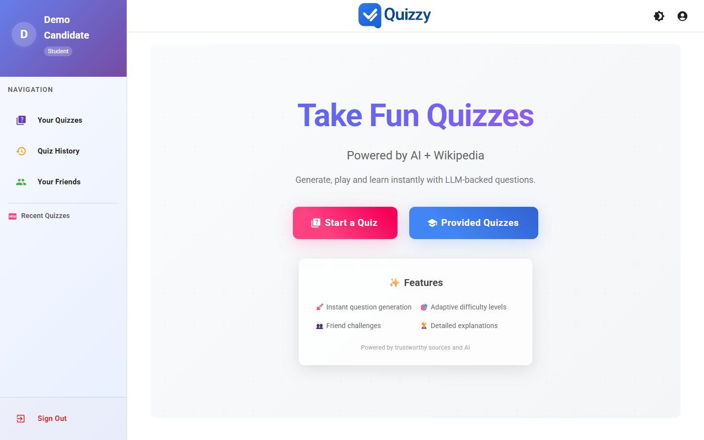
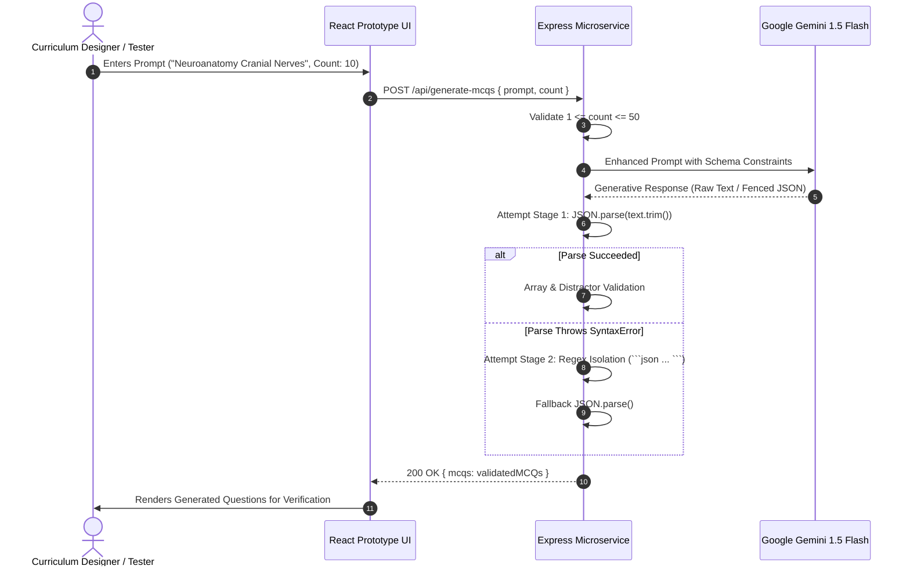

# 🧪 Quiz-Generator- (Algorithmic Prototype & Core Engine)

<div align="center">


### Foundational Algorithmic Proof-of-Concept for Generative MCQ Synthesis
*The original core engine that pioneered zero-shot psychometric multiple-choice question generation with Google Gemini 1.5 Flash.*

[](https://github.com)
[](https://react.dev)
[](https://vitejs.dev)
[](https://expressjs.com)
[](https://ai.google.dev)
[](LICENSE)

</div>

> [!IMPORTANT]
> **Production Upgrade Notice**: This repository preserves the initial algorithmic prototype and core generative proof-of-concept. For the full production enterprise release with MongoDB database persistence, JWT authentication, educator approval workflows, and interactive analytics, visit [**quiz-Generator--main**](file:///c:/Users/pandi/OneDrive/Desktop/github/quiz-Generator--main).

---

## Application Screenshot & Interface Preview

<div align="center">
  
</div>

---

## 🌐 Suite 5 Ecosystem & Cross-Repository Links

**quiz-Generator-** is the foundational core engine that seeded the **Suite 5 (Medical & AI Quiz Ecosystem)**:

| Repository | Role | Core Technology | Link |
| :--- | :--- | :--- | :--- |
| **quiz-Generator-** (This Repo) | Algorithmic Prototype & Core Generation Engine | Express / Google Generative AI / Vite Prototype | [quiz-Generator-](file:///c:/Users/pandi/OneDrive/Desktop/github/quiz-Generator-) |
| **quiz-Generator--main** | Enterprise AI MCQ Backend & Full-Stack Platform | React 19 / Express 5 / MongoDB / Gemini 1.5 Flash | [quiz-Generator--main](file:///c:/Users/pandi/OneDrive/Desktop/github/quiz-Generator--main) |
| **mcq-main-frontend** | Production Web Exam Center & Analytics Portal | React 19 / Vite / Recharts / Vercel Host | [mcq-main-frontend](file:///c:/Users/pandi/OneDrive/Desktop/github/mcq-main-frontend) |
| **DCP-QUIZZY** | Medical Mobile App Client & Licensing Engine | React Native / Expo 57 / Express / MongoDB | [DCP-QUIZZY](file:///c:/Users/pandi/OneDrive/Desktop/github/DCP-QUIZZY) |

---

## 📌 Executive Summary & Educational Impact

Before high-stakes examination systems can adopt Large Language Models (LLMs) for test generation, they require a deterministic proof-of-concept demonstrating that LLMs can reliably emit structured, schema-compliant questions without hallucinating invalid JSON or generating non-mutually exclusive distractors.

**Quiz-Generator-** was engineered to solve this foundational algorithmic challenge:
1. **Schema Formulation**: Defined the compact mathematical tuple format for questions: `["Question String", ["Option A", "Option B", "Option C", "Option D"], correctOptionIndex]`.
2. **Defensive Regex Parsing**: Developed the two-tier extraction algorithm that attempts raw JSON parsing and falls back to regex markdown fence isolation (````json ... ````) when LLM responses enclose code blocks.
3. **Array & Distractor Verification**: Guaranteed that every generated item contains exactly 4 distinct option strings and a valid 0-3 index pointer.

The successful validation of this core engine directly catalyzed the production architecture of both **quiz-Generator--main** and the **DCP-QUIZZY** medical licensing suite.

---

## 🚀 Key Features

- 🧠 **Zero-Shot Gemini 1.5 Flash MCQ Synthesis**: Prompt-engineered engine generating between 1 and 50 rigorous questions per prompt.
- 🛡️ **Dual-Stage Defensive Parser**: Resilient parsing pipeline that handles clean JSON strings as well as wrapped Markdown fences without runtime crashes.
- 📐 **Rigorous Schema Validation**: Enforces string types for questions, exactly four distractor options, and zero-indexed integer bounds `[0..3]`.
- ⚡ **Lightweight Express Microservice**: Minimalist Node.js API server (`mcq-backend/server.js`) optimized for rapid experimentation and prompt testing.
- 💻 **Interactive React 19 Playground**: Material-UI web interface allowing rapid evaluation of prompt variations, question outputs, and student quiz flows.
- 🔄 **Evolutionary Precursor**: Direct algorithmic predecessor to the enterprise production suite deployed in `quiz-Generator--main`.

---

## 🏛️ System Architecture

The following diagram illustrates the streamlined architecture of the prototype engine:

```mermaid
flowchart TD
    subgraph ClientPlayground["Interactive Client Prototype (React 19 + Vite)"]
        UI["Prompt Input & Question Viewer"]
        QuizUI["Interactive Quiz Session Component"]
        ResultsUI["Score & Answer Verification Display"]
    end

    subgraph CoreEngine["Core Microservice (mcq-backend)"]
        Server["Express.js Server (server.js:5000)"]
        Validator["Input Bounds Validator (1 <= Count <= 50)"]
        PromptBuilder["Structured Prompt Synthesizer"]
        Parser["Two-Stage Parser (JSON.parse + Regex Matcher)"]
        SchemaChecker["Array & Distractor Validator"]
    end

    subgraph AICloud["External AI Foundation"]
        Gemini["Google Gemini 1.5 Flash API"]
    end

    UI -->|"POST /api/generate-mcqs { prompt, count }"| Server
    Server --> Validator
    Validator --> PromptBuilder
    PromptBuilder -->|"Strict Tuple Prompt"| Gemini
    Gemini -->>|"Raw Generative Output"| Parser
    Parser --> SchemaChecker
    SchemaChecker -->>|"Validated MCQs Payload"| UI
    UI --> QuizUI
    QuizUI --> ResultsUI
```

---

## 🔄 Data Flow & Sequence Diagram

This sequence details the algorithmic execution path from raw topic input to validated question objects:



---

## 🛠️ Complete Tech Stack Breakdown

| Layer | Technology | Version | Purpose / Architectural Responsibility |
| :--- | :--- | :--- | :--- |
| **Frontend Framework** | React | `^19.1.1` | Component lifecycle, interactive test-taking, and state |
| **Build Tooling** | Vite | `^7.1.2` | Fast module reloading and development bundling |
| **UI Framework** | Material-UI (MUI) | `^7.3.1` | Baseline component styling, input fields, and dialogs |
| **Styling** | Emotion | `^11.14` | CSS-in-JS style rules and theme propagation |
| **Backend Framework** | Express.js | `^4.18+` | Lightweight microservice handling HTTP POST requests |
| **Generative AI** | `@google/generative-ai` | `^0.24.1` | Google Gemini 1.5 Flash API connector |
| **Parsing Utilities** | Custom Regex / Native JSON | ECMAScript 2023 | Resilient two-stage markdown and JSON extraction |
| **HTTP Communication** | Axios / Fetch API | Standard | Request dispatching between client and local server |

---

## 📂 Repository Directory Structure

```text
quiz-Generator-/
├── .gitignore                      # Git exclusion rules (protects node_modules & .env)
├── eslint.config.js                # ESLint configuration
├── index.html                      # HTML entry template
├── package.json                    # Frontend dependencies and Vite scripts
├── vite.config.js                  # Vite configuration
│
├── mcq-backend/                    # Algorithmic prototype backend
│   ├── .env.example                # Sanitized environment template
│   ├── package.json                # Express & Google Generative AI dependencies
│   └── server.js                   # Unified 85-line core generation engine
│
└── src/                            # React client prototype
    ├── assets/
    │   └── react.svg               # React vector emblem
    ├── components/                 # Component prototypes
    │   ├── admin/                  # Administrative forms
    │   │   ├── AdminDashboard.jsx
    │   │   ├── CreateQuiz.jsx
    │   │   ├── EditQuiz.jsx
    │   │   ├── QuestionForm.jsx
    │   │   ├── QuestionList.jsx
    │   │   ├── QuestionReview.jsx
    │   │   └── viewQuizzes.jsx
    │   ├── auth/                   # Client-side auth prototypes
    │   ├── common/                 # Navigation bars & public routes
    │   └── user/                   # Quiz session & result screens
    ├── contexts/                   # React Context state prototypes
    ├── hooks/                      # Custom hooks (useAuth, useQuiz)
    ├── pages/                      # Application route views
    ├── services/                   # API interaction scripts
    └── utils/                      # Storage helpers
```

---

## ⚡ Local Setup & Installation

### 1. Prerequisites
- **Node.js**: v20.x or higher installed (`node -v`)
- **npm**: v9+ installed (`npm -v`)
- **Google Gemini API Key**: Obtainable from [Google AI Studio](https://aistudio.google.com/)

---

### 2. Backend Engine Setup
```bash
# Navigate to the backend prototype directory
cd mcq-backend

# Create environment file from template
cp .env.example .env
```

Configure `mcq-backend/.env`:
```env
GEMINI_API_KEY=your_gemini_api_key_here
PORT=5000
```

Install dependencies and start the generation engine:
```bash
npm install
node server.js
# Output: Server running on port 5000
```

---

### 3. Frontend Playground Setup
In a new terminal window:
```bash
# Return to repository root
cd ..

# Install frontend dependencies
npm install

# Start Vite development server
npm run dev
# Server running at http://localhost:5173/
```

Test generating questions by supplying prompts such as `"Cardiovascular Physiology"`, `"Pharmacology Beta Blockers"`, or `"Pediatric Milestones"`.

---

## 📡 API Reference Table

| Method | Endpoint | Description | Auth Required | Request Payload |
| :--- | :--- | :--- | :---: | :--- |
| `POST` | `/api/generate-mcqs` | Generates validated 4-option MCQs via Gemini Flash | No | `{ "prompt": string, "count": number (1..50) }` |

### Sample Request
```json
{
  "prompt": "Pathophysiology of Myocardial Infarction",
  "count": 3
}
```

### Sample Response
```json
{
  "mcqs": [
    [
      "Which cardiac biomarker rises earliest following acute myocardial infarction?",
      ["Troponin I", "Myoglobin", "CK-MB", "LDH"],
      1
    ],
    [
      "ST-segment elevation in leads II, III, and aVF indicates infarction of which coronary territory?",
      ["Left anterior descending", "Left circumflex", "Right coronary artery", "Left main"],
      2
    ]
  ]
}
```

---

## 🚀 Transitioning to Production (`quiz-Generator--main`)

To elevate this prototype into a full enterprise application:

| Prototype Capability (`quiz-Generator-`) | Enterprise Production Feature (`quiz-Generator--main`) |
| :--- | :--- |
| In-memory question generation | Persistent **MongoDB Atlas** database storage |
| Open endpoints without credentials | **JWT Token Authorization** & **bcryptjs** password encryption |
| Uniform access model | **Role-Based Access Control (RBAC)** (Student vs Administrator) |
| Instant question display | **Educator Quality Review Pipeline** (`pending` / `accepted` / `rejected`) |
| Simple score output | **Recharts Interactive Data Visualizations** & chronological history |

👉 Navigate to [**quiz-Generator--main**](file:///c:/Users/pandi/OneDrive/Desktop/github/quiz-Generator--main) to inspect the complete enterprise implementation.

---

## 🛡️ Security, Performance & Best Practices

- **Sanitized Secrets**: Never commit `.env` files containing live Gemini keys. Always use `.env.example`.
- **Bounds Checking**: Enforces `count` boundaries between 1 and 50 to avoid runaway API consumption.
- **Fail-Safe Extraction**: Protects server stability by executing JSON regex fallbacks rather than terminating on unformatted LLM outputs.

---

## 📄 License

This project is licensed under the **MIT License** — see the [LICENSE](LICENSE) file for full details.

---

<div align="center">
  <sub>Part of the <b>Suite 5 Medical & AI Quiz Ecosystem</b>. The foundational proof-of-concept for automated psychometric question synthesis.</sub>
</div>
